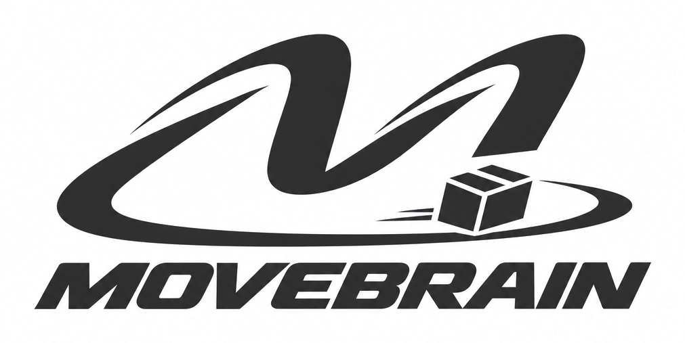
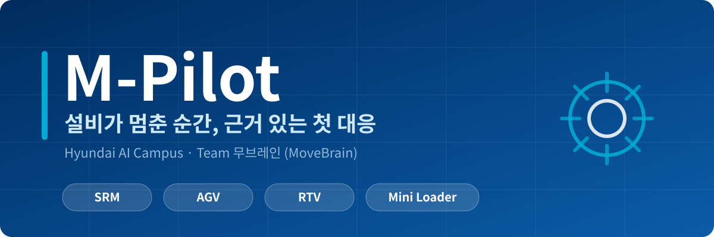
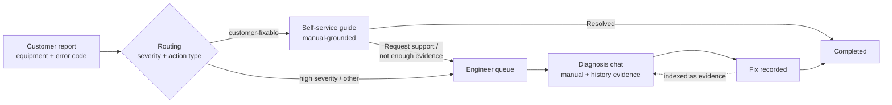
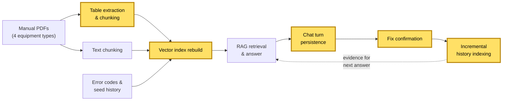

<p align="center">
  
</p>

<p align="center">
  
</p>

<p align="center">
  <b>Evidence-grounded RAG assistant for industrial equipment failures</b><br>
  Data layer · Jaeseo Lee (<a href="https://github.com/8113jsl-ui">@8113jsl-ui</a>)
</p>

<p align="center">
  <a href="README.md">한국어</a> · English
</p>

<p align="center">
  
  
  
  
  
  
  
  
</p>

> Personal portfolio fork of [movebrain/m-pilot](https://github.com/movebrain/m-pilot). All manuals, error codes, and service records in this repo are synthetic.


## Project Overview

### Background

- When equipment stops, field teams lose time figuring out what to do first.
- Manuals and past fix records are scattered, so checking evidence is slow.
- A general-purpose LLM sounds convincing but can suggest fixes with no basis.

### Solution

- Customers report by picking the equipment and error code. The error-code table's severity and action type decide the route automatically.
- Faults the customer can handle get a step-by-step self-service guide grounded in the manual.
- Dangerous or non-customer faults go to an engineer, who gets answers cited from the same equipment's manual and confirmed past fixes.
- With no evidence, the system says so instead of making something up.

### Key Features

| User | Feature | Description |
|---|---|---|
| Customer | Report | Pick equipment and error code, get a ticket number, auto-routed |
| Customer | Self-service guide | Step-by-step fix with manual citations, then "Resolved" or "Request support" |
| Customer | Report list & detail | Filter by status, view the engineer's fix once completed |
| Engineer | Dashboard | Past service history and new reports by status |
| Engineer | Diagnosis chat | Answers grounded in manuals and past fixes; falls back to all 4 equipment types when evidence is thin |
| Engineer | Fix record | Enter cause, action, and result to close the case; indexed as evidence immediately |

### Service Flow



### Project Info

| | |
|---|---|
| **Timeline** | Oct 21 – Nov 2, 2026 (2 weeks, Hyundai AI Campus bootcamp) |
| **Team** | MoveBrain, 7 engineers: 1 UI & lead, 3 data, 3 RAG |
| **Equipment** | SRM, AGV, RTV, Mini Loader (all manuals, error codes, and records are synthetic) |
| **Apps** | Separate customer app (port 7860) and engineer app (port 7861) |
| **Stack** | Python 3.11.9, Gradio, pdfplumber, MySQL, SQLAlchemy, Chroma, LangChain, pytest, GitHub Actions |
| **LLM** | OpenAI gpt-4o-mini |
| **Embeddings** | OpenAI text-embedding-3-small |

## My Role

I owned a core slice of the **data layer**: turning manual PDF tables into citable chunks, persisting engineer conversations and fixes safely under concurrency, and keeping the vector index in sync so every confirmed fix becomes evidence for the next answer.

| | |
|---|---|
| **Role** | Data layer engineer (1 of 3 on the data team) |
| **Ownership** | Table extraction & chunking, chat and fix persistence, vector index build & sync, RDB refactor |
| **Contributions** | 23 commits · 7 merged PRs · 5 test modules |

## Highlights

- **Built a table extraction pipeline** for equipment manual PDFs that keeps row and column structure, stitches tables split across pages, and cites printed page numbers, so every answer links to the page a technician would actually open.
- **Designed race-safe persistence** for chat turns and fix records with row locks and conditional updates. A case can't be closed twice or written to after it's closed.
- **Closed the feedback loop** between engineers and the retriever. A confirmed fix is indexed immediately and can ground the very next answer.
- **Made index rebuilds fail-safe.** Every document is built and validated before the old index is touched, so bad source data never wipes a working index.
- **Split a monolithic `rdb.py`** into a feature-based package without changing a single call site in other teams' code.


## Architecture

Data flow. Highlighted boxes are the parts I built.



## Engineering Deep Dives

### 1. Making manual tables citable

[`mpilot/db/parser/tables.py`](mpilot/db/parser/tables.py) · PRs [#57](https://github.com/movebrain/m-pilot/pull/57), [#103](https://github.com/movebrain/m-pilot/pull/103)

**Problem.** Most actionable information in equipment manuals (error codes, inspection steps, specs) lives in tables. Plain text extraction flattens rows and columns, so retrieval returns fragments with no context. PDF page indices also don't match the page numbers printed on the manual.

**Approach.**
- Extract tables page by page with pdfplumber and attach a caption and bounding box to each.
- Read the printed page number from the footer instead of using the PDF index.
- Detect continuation tables (no caption, same header row as the last table on the previous page) and carry the caption over.
- Flag merged, blank, and short-row cells for quality checks.
- Render each table as Markdown. Split long tables by row and repeat the caption and header row on every chunk.

**Outcome.** Every table chunk is self-describing when retrieved on its own, and citations point to the page a technician actually sees.

| Function | Responsibility |
|---|---|
| `_extract_tables` | Per-page extraction, cross-page table stitching |
| `_validate_table` | Locate blank or merged cells |
| `_table_to_drafts` | Markdown chunks with header repeated on split |

I also implemented an image-page OCR path ([`ocr.py`](mpilot/db/parser/ocr.py)) and parked it after review, since the current manuals have no image-only pages. Steps to re-enable it are documented in the module.

### 2. Race-safe conversation and fix persistence

[`mpilot/db/rdb/chat.py`](mpilot/db/rdb/chat.py) · PR [#98](https://github.com/movebrain/m-pilot/pull/98)

**Problem.** Two engineers, or one double click, can act on the same case at once. A case must never be completed twice, and closed cases or self-guide cases that haven't been escalated must not accept new turns.

**Approach.**
- Lock the case row with `SELECT ... FOR UPDATE` before checking its state.
- Write the fix record and flip the status to `completed` in a single transaction.
- Guard completion with a conditional `UPDATE` that only matches cases not yet completed.
- Auto-advance `received` to `in_progress` on the first engineer question.
- Validate input length (questions 1–2,000 chars, each fix field 1–5,000 chars) and raise typed errors (`ValidationError`, `NotFoundError`, `InvalidStateError`, `DependencyError`) that the UI maps to fixed user-facing messages.

**Outcome.** State transitions are enforced by the database, which keeps the UI and service layers simple.

| Function | Responsibility |
|---|---|
| `fetch_chat_turns` | Load a case's conversation in order |
| `save_chat_turn` | Persist a question and cited answer, advance status |
| `save_confirmed_resolution` | Persist the fix and close the case atomically |

### 3. A vector index that learns from confirmed fixes

[`mpilot/db/vectordb.py`](mpilot/db/vectordb.py) · PRs [#56](https://github.com/movebrain/m-pilot/pull/56), [#133](https://github.com/movebrain/m-pilot/pull/133)

**Problem.** Retrieval needs both manuals and real field fixes, and a fix confirmed a minute ago should be usable right away without restarting the app.

**Approach.**
- Rebuild two Chroma collections on startup: `manual` (error-code rows and manual chunks) and `history` (confirmed fixes).
- Upsert a single fix into `history` the moment an engineer confirms it.
- Enforce document ID rules: `error:` / `manual:` / `history:` prefixes, no `:` inside ID parts, no duplicates.
- Build and validate every document first, and only then reset the collections.
- Reject unconfirmed and self-guide cases from the history index.

**Outcome.** The assistant gets better as engineers close cases, and a bad data load fails loudly instead of leaving an empty index behind.

| Function | Responsibility |
|---|---|
| `rebuild_search_index` | Validate-then-rebuild both collections |
| `index_history` | Upsert one confirmed fix |

### 4. Refactoring without breaking teammates

[`mpilot/db/rdb/`](mpilot/db/rdb/) · PR [#152](https://github.com/movebrain/m-pilot/pull/152)

- Split `rdb.py` into `setup`, `cases`, `chat`, and `_common` modules.
- Re-exported the public API so `rdb.<function>` calls elsewhere in the codebase stayed the same.
- Migrated the 7 RDB test modules to the new layout.
- Co-built schema setup and the DB connection with the other two data engineers.

### 5. Team tooling

PR [#25](https://github.com/movebrain/m-pilot/pull/25)

- Wrote the team's first AI coding rules (`AI_RULES.md`, since retired) and `CLAUDE.md`, which is still the team's shared rules doc.
- Set up `.gitignore` on day one to keep secrets, vector DB files, and caches out of the repo.

## Testing

| Module | What it covers |
|---|---|
| `tests/test_parser_tables_ocr.py` | Table extraction, cross-page stitching, cell validation, row-based splitting |
| `tests/test_parser_types.py` | Shared types and bounding box ordering |
| `tests/test_rdb_chat_resolution.py` | Chat persistence, fix confirmation, rejection of closed or non-escalated cases |
| `tests/test_rdb_schema.py` | Table creation and reset |
| `tests/test_vectordb_indexing.py` | Index rebuild, history upsert, old index preserved when validation fails |
| `tests/conftest.py` | Shared MySQL fixture. CI fails instead of skipping when the test DB is unreachable, so a green build can't hide a broken DB. |

MySQL-backed tests run in GitHub Actions against a MySQL service container.

```bash
pytest tests/test_parser_tables_ocr.py tests/test_rdb_chat_resolution.py tests/test_vectordb_indexing.py
```


## Quick Start

```bash
python3.11 -m venv venv && source venv/bin/activate
pip install -r requirements.txt
cp .env.example .env

# UI only: no MySQL or API key needed
python app_customer.py --fake
```

For the full setup with MySQL and OpenAI, see [docs/RUN.md](docs/RUN.md) (Korean).

## My Pull Requests

| PR | Summary |
|---|---|
| [#25](https://github.com/movebrain/m-pilot/pull/25) | Team AI coding rules and `.gitignore` |
| [#56](https://github.com/movebrain/m-pilot/pull/56) | Vector index rebuild and confirmed-fix indexing |
| [#57](https://github.com/movebrain/m-pilot/pull/57) | Shared parser types, bbox validation, printed page numbering |
| [#98](https://github.com/movebrain/m-pilot/pull/98) | DB schema, connection, chat and fix persistence |
| [#103](https://github.com/movebrain/m-pilot/pull/103) | Table extraction, validation, chunking; image OCR (parked) |
| [#133](https://github.com/movebrain/m-pilot/pull/133) | Simplified index write path |
| [#152](https://github.com/movebrain/m-pilot/pull/152) | Split `rdb.py` into a feature-based package |

## What I Learned

- **Retrieval quality starts at ingestion.** Printed page numbers and repeated table headers did more for answer trust than any prompt tweak could.
- **Put invariants in the database.** Row locks and conditional updates made double submits a non-issue and kept the UI code simple.
- **Validate before you destroy.** Anything hard to undo, like wiping an index, runs only after the replacement is fully built and checked.
- **Readable code is a team feature.** Short inline comments and plain syntax made reviews faster for a team learning Python together.


## Team

| Name | Area | GitHub |
|:---:|:---:|:---:|
| 노동균 | UI & lead | [@rohdonggyun-lab](https://github.com/rohdonggyun-lab) |
| 김성일 | Data | [@tjddlf112015-jpg](https://github.com/tjddlf112015-jpg) |
| 손재호 | Data | [@thswogh](https://github.com/thswogh) |
| **이재서 (me)** | **Data** | [@8113jsl-ui](https://github.com/8113jsl-ui) |
| 도예진 | RAG | [@yejjini](https://github.com/yejjini) |
| 정혜윤 | RAG | [@hyey00n](https://github.com/hyey00n) |
| 한시온 | RAG | [@zionhann](https://github.com/zionhann) |

The original team README (Korean) is preserved at [docs/TEAM_README.md](docs/TEAM_README.md).
