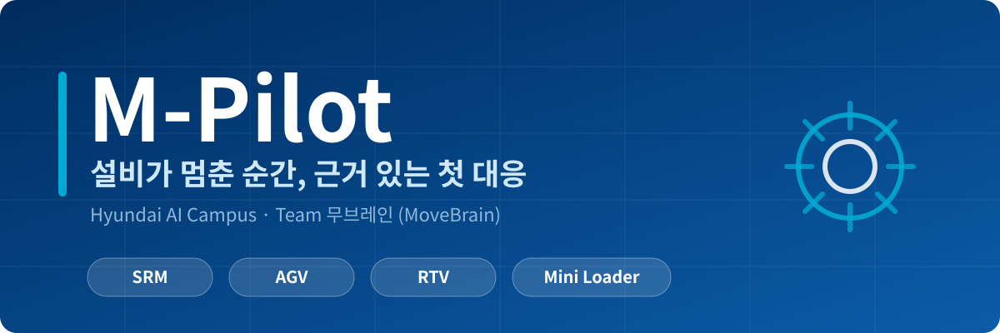
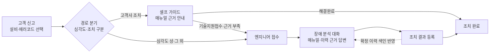
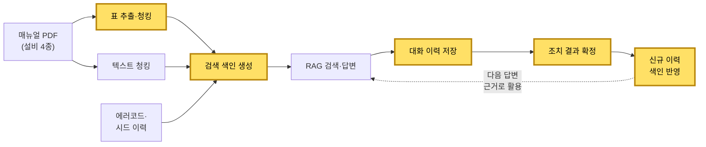

<p align="center">
  
</p>

<p align="center">
  
</p>

<p align="center">
  <b>근거 기반 설비 장애 대응 RAG 서비스</b><br>
  데이터 레이어 · 이재서 (<a href="https://github.com/8113jsl-ui">@8113jsl-ui</a>)
</p>

<p align="center">
  한국어 · <a href="README.en.md">English</a>
</p>

<p align="center">
  
  
  
  
  
  
  
  
</p>

> 원본 팀 저장소 [movebrain/m-pilot](https://github.com/movebrain/m-pilot)의 개인 포트폴리오용 포크. 저장소 내 매뉴얼·에러코드·서비스 이력은 모두 가상 데이터.


## 프로젝트 개요

### 배경

- 설비 정지 시 현장에서 "무엇부터 해야 하지?"로 초기 대응 지연
- 매뉴얼과 과거 조치 이력이 흩어져 있어 근거 확인에 시간 소요
- 일반 LLM 답변은 그럴듯하지만 근거 없는 조치 안내 위험

### 해결

- 설비·에러코드 선택만으로 신고, 에러코드 표의 심각도·조치 구분으로 처리 경로 자동 분기
- 고객이 조치 가능한 고장: 매뉴얼 근거 기반 단계별 셀프 가이드
- 위험하거나 고객이 조치할 수 없는 고장: 엔지니어 접수, 같은 설비의 매뉴얼·확정 조치 근거로 출처가 붙은 답변 제공
- 근거가 없으면 지어내지 않고 근거 없음만 안내

### 주요 기능

| 사용자 | 기능 | 내용 |
|---|---|---|
| 고객 | 신고 작성 | 설비·에러코드 선택, 접수번호 발급, 처리 경로 자동 분기 |
| 고객 | 셀프 가이드 | 단계별 조치 안내와 매뉴얼 출처, [해결완료]·[기술지원접수] 선택 |
| 고객 | 신고 목록·상세 | 상태별 조회, 엔지니어 처리 건의 조치 결과 확인 |
| 엔지니어 | 대시보드 | 기존 서비스 이력과 신규 신고를 상태별로 조회 |
| 엔지니어 | 장애 분석 대화 | 매뉴얼·과거 이력 근거 답변, 근거 부족 시 설비 4종 전체 재검색 |
| 엔지니어 | 조치 결과 저장 | 원인·조치·결과 입력 후 완료, 다음 질문의 근거로 즉시 반영 |

### 서비스 흐름



### 프로젝트 정보

| | |
|---|---|
| **기간** | 2026.10.21 ~ 2026.11.02 (2주, 현대AI캠퍼스 1차 프로젝트) |
| **팀** | 무브레인(MoveBrain) 7명 (UI·총괄 1, 데이터 3, RAG 3) |
| **대상 설비** | SRM, AGV, RTV, Mini Loader 4종 (매뉴얼·에러코드·이력 모두 가상 데이터) |
| **앱 구성** | 고객 앱(포트 7860)·엔지니어 앱(포트 7861) 분리 |
| **기술** | Python 3.11.9, Gradio, pdfplumber, MySQL, SQLAlchemy, Chroma, LangChain, pytest, GitHub Actions |
| **LLM** | OpenAI gpt-4o-mini |
| **임베딩** | OpenAI text-embedding-3-small |

## 내 역할

**데이터 레이어** 핵심 기능 담당: 매뉴얼 PDF 표의 출처 있는 청크 변환, 동시 처리에 안전한 대화·조치 이력 저장, 확정 조치의 즉시 검색 색인 반영.

| | |
|---|---|
| **역할** | 데이터 레이어 개발 (데이터 파트 3인 중 1인) |
| **담당 영역** | 매뉴얼 표 추출·청킹, 대화·조치 이력 저장, 검색 색인 생성·갱신, RDB 구조 개선 |
| **기여** | 커밋 23건 · PR 7건 머지 · 테스트 모듈 5건 |

## 핵심 성과

- **매뉴얼 PDF 표 추출 파이프라인 개발**: 행·열 구조 유지, 쪽 넘김 표 자동 연결, 인쇄 쪽 번호 기준 출처 표기로 답변 출처와 실제 매뉴얼 쪽 일치
- **동시 처리 안전한 이력 저장 설계**: 행 잠금·조건부 UPDATE로 중복 완료 및 완료 후 저장 차단
- **조치 결과 피드백 루프 구현**: 엔지니어가 확정한 조치를 즉시 색인에 반영, 다음 답변 근거로 활용
- **색인 재생성 안정성 확보**: 신규 문서 전체 검증 후 기존 색인 교체, 원자료 오류 시 기존 색인 보존
- **RDB 모듈 구조 개선**: 단일 `rdb.py`를 기능별 패키지로 분리, 타 파트 호출 코드 변경 없음


## 아키텍처

데이터 흐름 중 노란색 박스: 담당 영역



### 디렉토리 구조

★ 직접 개발 · ☆ 공동 개발 · ◆ 구조 분리(#152)

```text
m-pilot/
├── app.py                          # 앱 조립·실행 공통부
├── app_customer.py                 # 고객 앱 진입점 (7860)
├── app_engineer.py                 # 엔지니어 앱 진입점 (7861)
├── mpilot/
│   ├── config.py                   # 앱 설정 로드·검증
│   ├── models.py                   # 업무 데이터 정의·업무 규칙
│   ├── service.py                  # 화면과 DB·RAG 연결 (접수·질문·완료)
│   ├── db/                         # [데이터 레이어]
│   │   ├── parser/                 # 매뉴얼 PDF → 출처 붙은 검색 단위
│   │   │   ├── __init__.py         # ☆ 매뉴얼 파싱 조립 (parse_manuals)
│   │   │   ├── tables.py           # ★ 표 추출·검증·청킹
│   │   │   ├── ocr.py              # ★ 이미지 페이지 OCR (보류)
│   │   │   ├── types.py            # ☆ 표·텍스트 공유 타입
│   │   │   ├── text.py             #   텍스트 추출·인쇄 쪽 번호
│   │   │   ├── chunks.py           #   청크 번호 부여
│   │   │   └── cache.py            #   파싱 결과 캐시
│   │   ├── rdb/                    # ◆ 신고·대화·조치 저장 (기능별 패키지)
│   │   │   ├── __init__.py         # ◆ 공개 함수 재노출
│   │   │   ├── _common.py          # ◆ 엔진 보관·변환 공통 도구
│   │   │   ├── setup.py            # ☆ DB 연결·스키마 생성, 초기 자료 적재
│   │   │   ├── cases.py            # ◆ 신고 저장·조회
│   │   │   └── chat.py             # ★ 대화 저장·조회, 조치 확정
│   │   ├── schemas.py              # ☆ 관계형 DB 테이블 정의
│   │   └── vectordb.py             # ★ 검색 색인 생성·이력 반영
│   ├── rag/                        # 근거 검색, 답변 생성, 인용 검증
│   └── ui/                         # 고객·엔지니어 화면
├── fake/                           # DB 없이 실행하는 시연용 가짜 구현
├── scripts/                        # 초기 자료 생성·적재, RAG 평가
├── prompts/                        # 모델 지시문
├── tests/
│   ├── conftest.py                 # ★ MySQL 테스트 공용 fixture
│   ├── test_parser_tables_ocr.py   # ★ 표 추출·분할
│   ├── test_parser_types.py        # ★ 공유 타입·bbox 검증
│   ├── test_rdb_chat_resolution.py # ★ 대화·조치 저장
│   ├── test_rdb_schema.py          # ★ 테이블 생성·초기화
│   ├── test_vectordb_indexing.py   # ★ 색인 재생성·이력 반영
│   └── ...                         #   그 외 팀 테스트
├── data/                           # 매뉴얼 PDF 4종, 에러코드·이력 원자료 (가상)
├── docs/                           # 기획 의도·명세·실행 가이드, 팀 README
├── images/                         # README 배너
├── CLAUDE.md                       # ☆ 팀 AI 코딩 규칙 (첫 버전 작성)
└── .github/workflows/              # CI (GitHub Actions)
```

- `vectordb.py`의 저장소 연결·원문 조회(`connect`, `get_store`, `get_document`)는 팀원 담당
- 의존 방향: `app*.py` → `ui`·`service` → `db`·`rag` → `models` (단방향)

## 주요 구현

### 1. 매뉴얼 표 출처화

[`mpilot/db/parser/tables.py`](mpilot/db/parser/tables.py) · PR [#57](https://github.com/movebrain/m-pilot/pull/57), [#103](https://github.com/movebrain/m-pilot/pull/103)

**문제**
- 에러코드·점검 절차·사양 등 핵심 정보 대부분이 표 형태
- 일반 텍스트 추출 시 행·열이 섞여 맥락 없는 조각 검색
- PDF 순번과 매뉴얼 인쇄 쪽 번호 불일치

**해결**
- pdfplumber 기반 쪽별 표 추출, 캡션·위치(bbox) 부여
- 꼬리글 인쇄 쪽 번호 사용
- 캡션 없이 앞 쪽 마지막 표와 머리글이 같은 표를 이어진 표로 판단, 캡션 승계
- 병합 셀·빈 셀·누락 칸 검출
- 마크다운 표 변환, 긴 표는 행 단위 분할 후 조각마다 캡션·머리글 재부착

**결과**
- 표 조각 단독 검색 시에도 표 맥락 유지
- 답변 출처가 실제 매뉴얼 쪽과 일치

| 함수 | 기능 |
|---|---|
| `_extract_tables` | 쪽별 표 추출, 쪽 넘김 표 연결 |
| `_validate_table` | 빈 셀·병합 셀 좌표 검출 |
| `_table_to_drafts` | 마크다운 청크 생성, 분할 시 머리글 반복 |

이미지 페이지 OCR 경로([`ocr.py`](mpilot/db/parser/ocr.py))도 구현 후 리뷰 합의로 보류 (현재 매뉴얼에 이미지 페이지 없음, 재활성화 절차 모듈 내 문서화).

### 2. 동시 처리 안전한 대화·조치 이력 저장

[`mpilot/db/rdb/chat.py`](mpilot/db/rdb/chat.py) · PR [#98](https://github.com/movebrain/m-pilot/pull/98)

**문제**
- 엔지니어 2명 동시 작업 또는 중복 클릭 시 같은 건에 대한 동시 처리 발생
- 동일 건 중복 완료, 완료 건·이관 전 셀프 가이드 건에 대한 저장 차단 필요

**해결**
- `SELECT ... FOR UPDATE`로 신고 행 잠금 후 상태 확인
- 조치 기록 저장과 `completed` 전환을 단일 트랜잭션으로 처리
- 미완료 건에만 적용되는 조건부 `UPDATE`로 완료 처리 보호
- 첫 질문 저장 시 `received` → `in_progress` 자동 전환
- 입력 길이 검증 (질문 1~2,000자, 조치 항목별 1~5,000자), 오류 유형별 예외 분리 (`ValidationError`, `NotFoundError`, `InvalidStateError`, `DependencyError`)

**결과**
- 상태 전환 규칙을 DB 단에서 보장, UI·서비스 계층 단순화

| 함수 | 기능 |
|---|---|
| `fetch_chat_turns` | 신고 건별 대화 이력 조회 |
| `save_chat_turn` | 질문·출처 포함 답변 저장, 상태 전환 |
| `save_confirmed_resolution` | 조치 결과 저장 및 완료 확정 |

### 3. 확정 조치 기반 검색 색인

[`mpilot/db/vectordb.py`](mpilot/db/vectordb.py) · PR [#56](https://github.com/movebrain/m-pilot/pull/56), [#133](https://github.com/movebrain/m-pilot/pull/133)

**문제**
- 매뉴얼과 실제 현장 조치 이력을 함께 검색해야 함
- 방금 확정된 조치도 앱 재시작 없이 바로 활용 필요

**해결**
- 앱 시작 시 Chroma 컬렉션 2개 재생성: `manual`(에러코드 행·매뉴얼 청크), `history`(확정 조치)
- 조치 확정 즉시 해당 건 `history`에 upsert
- 문서 ID 규칙 검증: `error:`·`manual:`·`history:` 접두어, ID 구성 요소 내 `:` 금지, 중복 금지
- 전체 문서 생성·검증 후에만 기존 컬렉션 초기화
- 미확정 건·셀프 가이드 건 이력 등록 차단

**결과**
- 조치 완료 건이 쌓일수록 답변 근거 확대
- 잘못된 원자료 적재 시 빈 색인 대신 명확한 오류로 중단

| 함수 | 기능 |
|---|---|
| `rebuild_search_index` | 검증 후 두 컬렉션 재생성 |
| `index_history` | 확정 조치 1건 upsert |

### 4. RDB 모듈 구조 개선

[`mpilot/db/rdb/`](mpilot/db/rdb/) · PR [#152](https://github.com/movebrain/m-pilot/pull/152)

- `rdb.py`를 `setup`·`cases`·`chat`·`_common` 모듈로 분리
- 공개 함수 재노출로 기존 `rdb.<함수>` 호출 방식 유지
- RDB 테스트 모듈 7건 신규 구조 대응
- 스키마 생성·DB 연결 기능 공동 개발 (데이터 파트 3인)

### 5. 협업 환경 구성

PR [#25](https://github.com/movebrain/m-pilot/pull/25)

- 팀 AI 코딩 규칙 첫 버전 작성 (`AI_RULES.md`는 이후 정리되어 삭제, `CLAUDE.md`는 팀 공용 규칙 문서로 유지)
- 프로젝트 첫날 `.gitignore` 구성 (비밀 정보·벡터DB·캐시 업로드 방지)

## 테스트

| 모듈 | 검증 항목 |
|---|---|
| `tests/test_parser_tables_ocr.py` | 표 추출, 쪽 넘김 표 연결, 셀 검증, 행 단위 분할 |
| `tests/test_parser_types.py` | 공유 타입, bbox 좌표 순서 |
| `tests/test_rdb_chat_resolution.py` | 대화 저장, 조치 확정, 완료·이관 전 건 차단 |
| `tests/test_rdb_schema.py` | 테이블 생성·초기화 |
| `tests/test_vectordb_indexing.py` | 색인 재생성, 이력 upsert, 검증 실패 시 기존 색인 보존 |
| `tests/conftest.py` | MySQL 공용 fixture, CI에서 테스트 DB 연결 실패 시 건너뛰지 않고 실패 처리 |

MySQL 테스트는 GitHub Actions의 MySQL 서비스 컨테이너에서 실행.

```bash
pytest tests/test_parser_tables_ocr.py tests/test_rdb_chat_resolution.py tests/test_vectordb_indexing.py
```


## 빠른 실행

```bash
python3.11 -m venv venv && source venv/bin/activate
pip install -r requirements.txt
cp .env.example .env

# 화면만 확인 (MySQL·API 키 불필요)
python app_customer.py --fake
```

MySQL·OpenAI 포함 전체 실행: [docs/RUN.md](docs/RUN.md)

## 기여 PR

| PR | 내용 |
|---|---|
| [#25](https://github.com/movebrain/m-pilot/pull/25) | 팀 AI 코딩 규칙, `.gitignore` |
| [#56](https://github.com/movebrain/m-pilot/pull/56) | 검색 색인 재생성, 확정 조치 색인 반영 |
| [#57](https://github.com/movebrain/m-pilot/pull/57) | 파서 공유 타입, bbox 검증, 인쇄 쪽 번호 기준 |
| [#98](https://github.com/movebrain/m-pilot/pull/98) | DB 스키마·연결, 대화·조치 저장 |
| [#103](https://github.com/movebrain/m-pilot/pull/103) | 표 추출·검증·청킹, 이미지 OCR(보류) |
| [#133](https://github.com/movebrain/m-pilot/pull/133) | 색인 저장 코드 단순화 |
| [#152](https://github.com/movebrain/m-pilot/pull/152) | `rdb.py` 기능별 패키지 분리 |

## 회고

- **검색 품질은 수집 단계에서 결정**: 인쇄 쪽 번호, 표 머리글 반복이 프롬프트 조정보다 답변 신뢰도에 직접적인 영향
- **불변 조건은 DB에서 보장**: 행 잠금·조건부 UPDATE로 중복 제출 문제 해소, UI 코드 단순화
- **삭제 전 검증**: 색인 초기화처럼 되돌리기 어려운 작업은 대체 데이터 생성·검증 완료 후 실행
- **읽기 쉬운 코드도 팀 기능**: 줄 단위 한글 주석, 단순 문법 위주 작성으로 리뷰 속도 개선


## 팀

| 이름 | 파트 | GitHub |
|:---:|:---:|:---:|
| 노동균 | UI·총괄 | [@rohdonggyun-lab](https://github.com/rohdonggyun-lab) |
| 김성일 | 데이터 | [@tjddlf112015-jpg](https://github.com/tjddlf112015-jpg) |
| 손재호 | 데이터 | [@thswogh](https://github.com/thswogh) |
| **이재서 (본인)** | **데이터** | [@8113jsl-ui](https://github.com/8113jsl-ui) |
| 도예진 | RAG | [@yejjini](https://github.com/yejjini) |
| 정혜윤 | RAG | [@hyey00n](https://github.com/hyey00n) |
| 한시온 | RAG | [@zionhann](https://github.com/zionhann) |

원본 팀 README: [docs/TEAM_README.md](docs/TEAM_README.md)
