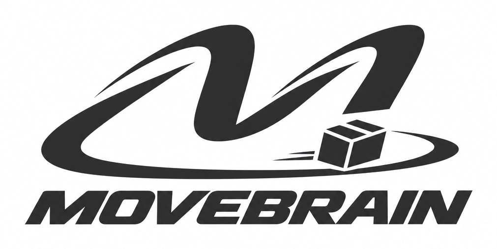
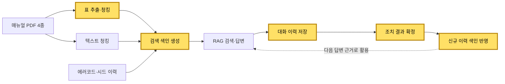

<p align="center">
  
</p>

<h1 align="center">M-Pilot</h1>

<p align="center">
  설비 장애 대응 RAG 서비스 · DB 파트 이재서
</p>

<p align="center">
  
  
  
  
  
</p>

> 원본 팀 저장소: [movebrain/m-pilot](https://github.com/movebrain/m-pilot) (개인 포트폴리오용 포크)
> 저장소 내 매뉴얼·에러코드·서비스 이력은 모두 가상 데이터

## 프로젝트 개요

| 항목 | 내용 |
|---|---|
| 프로젝트 | 설비 에러코드 신고 접수, 셀프 가이드·엔지니어 접수 분기, 매뉴얼·과거 조치 근거 기반 답변 제공 |
| 기간 | 2026.10.21 ~ 2026.11.02 (현대AI캠퍼스 1차 프로젝트) |
| 인원 | 7명 (UI·총괄 1, DB 3, RAG 3) |
| 담당 | DB 파트: 매뉴얼 표 추출·청킹, 대화·조치 이력 저장, 검색 색인 생성·갱신 |
| 기여 | 커밋 23건, PR 7건 머지, 테스트 파일 5건 + 공용 fixture |
| 기술 | Python 3.12, pdfplumber, MySQL, SQLAlchemy, Chroma, LangChain, pytest |

## 담당 업무

| 구분 | 업무 | 관련 PR |
|---|---|---|
| 데이터 수집 | 매뉴얼 PDF 표 추출·검증·청킹 기능 개발 | [#57](https://github.com/movebrain/m-pilot/pull/57) [#103](https://github.com/movebrain/m-pilot/pull/103) |
| 데이터 저장 | 엔지니어 대화·조치 이력 저장 기능 개발 | [#98](https://github.com/movebrain/m-pilot/pull/98) |
| 검색 | 벡터 검색 색인 생성 및 신규 이력 반영 기능 개발 | [#56](https://github.com/movebrain/m-pilot/pull/56) [#133](https://github.com/movebrain/m-pilot/pull/133) |
| 구조 개선 | RDB 모듈 기능별 패키지 분리 | [#152](https://github.com/movebrain/m-pilot/pull/152) |
| 협업 환경 | 팀 AI 코딩 규칙 문서 작성, `.gitignore` 구성 | [#25](https://github.com/movebrain/m-pilot/pull/25) |

### 데이터 흐름 (노란색: 담당 영역)



## 주요 구현 내용

### 1. 매뉴얼 표 추출·청킹 기능 개발

`mpilot/db/parser/tables.py`

- pdfplumber 기반 쪽별 표 추출, 캡션·위치(bbox) 정보 부여
- PDF 순번 대신 꼬리글 인쇄 쪽 번호 사용 → 답변 출처와 실제 매뉴얼 쪽 일치
- 여러 쪽에 걸친 표 자동 연결 (머리글 비교 후 앞 표 캡션 승계)
- 병합 셀·빈 셀·누락 칸 검출 기능 구현
- 긴 표 행 단위 분할, 분할 조각마다 캡션·머리글 재부착 → 조각 단독 검색 시에도 표 맥락 유지
- 이미지 페이지 OCR 경로 구현 후 보류 (현재 매뉴얼에 이미지 페이지 없음, 재활성화 절차 문서화)

| 함수 | 기능 |
|---|---|
| [`_extract_tables`](mpilot/db/parser/tables.py) | 쪽별 표 추출, 쪽 넘김 표 연결 |
| [`_validate_table`](mpilot/db/parser/tables.py) | 문제 셀 좌표 검출 |
| [`_table_to_drafts`](mpilot/db/parser/tables.py) | 마크다운 표 청크 생성, 길이 초과 시 분할 |
| [`ocr.py`](mpilot/db/parser/ocr.py) | 이미지 페이지 OCR (보류) |

### 2. 대화·조치 이력 저장 기능 개발

`mpilot/db/rdb/chat.py`

- 엔지니어 질문·RAG 답변(출처 포함) 저장 및 조회 기능 구현
- 첫 질문 저장 시 신고 상태 `접수` → `조치 중` 자동 전환
- 조치 결과(원인·조치·결과) 등록과 `조치 완료` 처리를 단일 트랜잭션으로 구성
- `SELECT ... FOR UPDATE` 행 잠금으로 완료 건·이관 전 건 저장 차단
- 조건부 UPDATE 적용으로 동일 건 중복 완료 방지
- 입력값 길이 검증, 오류 유형별 예외 분리 (`ValidationError`, `NotFoundError`, `InvalidStateError`, `DependencyError`)

| 함수 | 기능 |
|---|---|
| [`fetch_chat_turns`](mpilot/db/rdb/chat.py) | 신고 건별 대화 이력 조회 |
| [`save_chat_turn`](mpilot/db/rdb/chat.py) | 질문·답변 저장, 상태 전환 |
| [`save_confirmed_resolution`](mpilot/db/rdb/chat.py) | 조치 결과 저장 및 완료 확정 |

### 3. 검색 색인 생성 및 신규 이력 반영 기능 개발

`mpilot/db/vectordb.py`

- 앱 실행 시 Chroma 색인 전체 재생성 (매뉴얼·에러코드 / 확정 이력 컬렉션 분리)
- 조치 완료 즉시 해당 이력 색인 추가 → 신규 해결 사례를 다음 답변 근거로 바로 활용
- 문서 ID 규칙 검증 후 기존 색인 삭제 → 원자료 오류 시 기존 색인 보존
- 미확정 건·셀프 가이드 건 이력 등록 차단

| 함수 | 기능 |
|---|---|
| [`rebuild_search_index`](mpilot/db/vectordb.py) | 검색 색인 전체 재생성 |
| [`index_history`](mpilot/db/vectordb.py) | 확정 조치 이력 1건 색인 반영 |

### 4. RDB 모듈 구조 개선

`mpilot/db/rdb/`

- 단일 파일 `rdb.py`를 `setup`·`cases`·`chat`·`_common` 패키지로 분리
- 공개 함수 재노출로 기존 호출 방식(`rdb.<함수>`) 유지 → 타 파트 코드 수정 없음
- 기존 RDB 테스트 7건 신규 구조 대응
- 스키마 생성·DB 연결 기능 공동 개발 (DB 파트 3인)

### 5. 협업 환경 구성

- 프로젝트 초기 팀 AI 코딩 규칙 문서(`AI_RULES.md`, `CLAUDE.md`) 작성
- 기획서(intent·spec) 기준 심각도 표기 정비
- 비밀 정보·벡터DB·캐시 업로드 방지용 `.gitignore` 구성
- 현재 `AI_RULES.md`는 정리되어 삭제, `CLAUDE.md`는 팀 공용 규칙 문서로 유지

## 테스트

| 파일 | 검증 항목 |
|---|---|
| `tests/test_parser_tables_ocr.py` | 표 추출, 쪽 넘김 표 연결, 문제 셀 검출, 긴 표 분할 |
| `tests/test_parser_types.py` | 공유 타입, bbox 좌표 순서 검증 |
| `tests/test_rdb_chat_resolution.py` | 대화 저장·조회, 조치 확정, 완료 건·이관 전 건 차단 |
| `tests/test_rdb_schema.py` | 테이블 생성·초기화 |
| `tests/test_vectordb_indexing.py` | 색인 재생성, 이력 반영·덮어쓰기, 검증 실패 시 기존 색인 보존 (17건) |
| `tests/conftest.py` | MySQL 테스트 DB 공용 fixture, CI 연결 실패 시 테스트 실패 처리 |

```bash
pip install -r requirements.txt
pytest tests/test_parser_tables_ocr.py tests/test_rdb_chat_resolution.py tests/test_vectordb_indexing.py
```

## 기여 PR

| PR | 내용 |
|---|---|
| [#25](https://github.com/movebrain/m-pilot/pull/25) | 팀 AI 코딩 규칙 문서, `.gitignore` 추가 |
| [#56](https://github.com/movebrain/m-pilot/pull/56) | 검색 색인 재생성 및 확정 이력 반영 기능 개발 |
| [#57](https://github.com/movebrain/m-pilot/pull/57) | 표·텍스트 공유 타입 정의, bbox 검증, 쪽 번호 기준 정리 |
| [#98](https://github.com/movebrain/m-pilot/pull/98) | DB 스키마·연결, 대화·조치 저장 기능 개발 |
| [#103](https://github.com/movebrain/m-pilot/pull/103) | 표 추출·검증·청킹 기능 개발, 이미지 OCR(보류) |
| [#133](https://github.com/movebrain/m-pilot/pull/133) | 색인 저장 코드 단순화 |
| [#152](https://github.com/movebrain/m-pilot/pull/152) | RDB 모듈 기능별 패키지 분리 |

## 회고

- 출처 정확도 확보: 인쇄 쪽 번호 사용, 표 조각별 머리글 재부착으로 답변 출처 신뢰도 개선
- 상태 전환 안정성: 행 잠금·조건부 UPDATE로 중복 처리 방지 로직을 DB 단에서 처리
- 데이터 보호: 색인 재생성 시 검증 선행, 실패 시 기존 데이터 유지
- 코드 가독성: 줄 단위 한글 주석, 단순 문법 위주 리팩터링으로 팀 리뷰 효율 개선

## 팀 구성 및 전체 문서

- 서비스 전체 소개: [docs/TEAM_README.md](docs/TEAM_README.md)
- 실행 방법: [docs/RUN.md](docs/RUN.md)

| 이름 | 파트 | GitHub |
|:---:|:---:|:---:|
| 노동균 | UI·총괄 | [@rohdonggyun-lab](https://github.com/rohdonggyun-lab) |
| 김성일 | DB | [@tjddlf112015-jpg](https://github.com/tjddlf112015-jpg) |
| 손재호 | DB | [@thswogh](https://github.com/thswogh) |
| 이재서 | DB | [@8113jsl-ui](https://github.com/8113jsl-ui) |
| 도예진 | RAG | [@yejjini](https://github.com/yejjini) |
| 정혜윤 | RAG | [@hyey00n](https://github.com/hyey00n) |
| 한시온 | RAG | [@zionhann](https://github.com/zionhann) |
