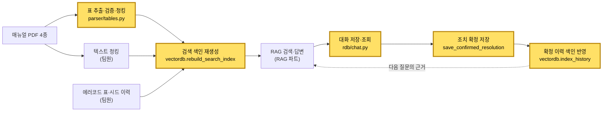

<p align="center">
  
</p>

<h1 align="center">M-Pilot · 이재서 포트폴리오</h1>

<p align="center">
  설비 장애 대응 RAG 서비스 <b>M-Pilot</b>에서 <b>DB 파트</b>를 맡았습니다.<br>
  매뉴얼 PDF의 <b>표를 검색 가능한 근거로 바꾸고</b>, 엔지니어의 <b>대화·조치 기록을 안전하게 저장</b>하고,<br>
  그 기록이 <b>다음 답변의 근거가 되도록 검색 색인</b>에 반영하는 부분을 만들었습니다.
</p>

<p align="center">
  
  
  
  
  
</p>

> 원본 팀 저장소는 [movebrain/m-pilot](https://github.com/movebrain/m-pilot)이며, 이 저장소는 개인 포트폴리오용 포크입니다.
> 저장소의 모든 데이터(매뉴얼, 에러코드, 서비스 이력)는 **가상**입니다.

---

## 한눈에 보기

| 항목 | 내용 |
|---|---|
| 프로젝트 | M-Pilot: 고객이 설비 에러코드로 신고하면 셀프 가이드 또는 엔지니어 접수로 나누고, 엔지니어에게는 매뉴얼·과거 조치 근거가 붙은 답을 주는 RAG 서비스 |
| 기간 | 2026.10.20 ~ 2026.11.02 (부트캠프 팀 프로젝트) |
| 팀 | 7명 (UI·총괄 1, **DB 3**, RAG 3) |
| 내 역할 | **DB 파트**: 매뉴얼 표 추출·청킹, 대화·조치 저장, 검색 색인 생성·이력 반영, 팀 AI 규칙 문서 |
| 기여 | 커밋 23개, 직접 작성한 PR 7개 머지 (#25 #56 #57 #98 #103 #133 #152), 테스트 파일 5개 + 공용 `conftest.py` |
| 기술 | Python 3.12, pdfplumber, MySQL + SQLAlchemy(PyMySQL), Chroma, LangChain, pytest |

---

## 내가 만든 것

전체 데이터 흐름에서 **노란 칸**이 제가 맡은 부분입니다.



### 1. 매뉴얼 표를 검색 가능한 근거로 — `mpilot/db/parser/tables.py`

설비 매뉴얼의 핵심 정보(에러코드, 점검 항목, 규격)는 대부분 **표** 안에 있습니다. 표를 일반 텍스트처럼 읽으면 행과 열이 섞여 RAG가 엉뚱한 근거를 가져옵니다. 그래서 표만 따로 뽑아 구조를 지킨 채 청크로 만들었습니다.

| 함수 | 하는 일 |
|---|---|
| [`_extract_tables`](mpilot/db/parser/tables.py) | pdfplumber로 쪽마다 표를 행·열 구조로 뽑고 캡션과 위치(bbox)를 붙입니다. 쪽 번호는 PDF 순번이 아니라 **꼬리글에 인쇄된 쪽 번호**를 써서, 답변의 출처가 사람이 보는 매뉴얼 쪽과 일치합니다. |
| (쪽 넘김 표 처리) | 다음 쪽 맨 위 표가 캡션 없이 **앞 표와 같은 머리글**로 시작하면 이어진 표로 보고 앞 표의 캡션을 이어받습니다. |
| [`_validate_table`](mpilot/db/parser/tables.py) | 병합 셀(`None`), 공백 셀, 짧은 행의 모자란 칸 좌표를 찾아 추출 품질을 점검합니다. |
| [`_table_to_drafts`](mpilot/db/parser/tables.py) | 표를 캡션 + 마크다운 표 초안으로 바꿉니다. 길이 기준을 넘으면 **행 단위로 나누고, 나눈 조각마다 캡션과 머리글 행을 다시 붙여** 조각 하나만 검색돼도 무슨 표의 어떤 열인지 알 수 있게 했습니다. |
| [`ocr.py`](mpilot/db/parser/ocr.py) (보류) | 글자가 없는 이미지 쪽을 찾아 비전 모델로 전사하는 경로를 구현했으나, 현재 매뉴얼 4종에 이미지 쪽이 없어 리뷰 합의로 **주석 처리해 보류**했습니다. 다시 켜는 방법을 모듈 문서에 남겼습니다. |

공유 타입 `RawTable`·`ChunkDraft` 정의와 bbox 좌표 순서 검증도 함께 넣었습니다(#57).

### 2. 대화·조치 기록을 안전하게 저장 — `mpilot/db/rdb/chat.py`

| 함수 | 하는 일 |
|---|---|
| [`fetch_chat_turns`](mpilot/db/rdb/chat.py) | 신고 건의 엔지니어 대화를 순서대로 불러옵니다. |
| [`save_chat_turn`](mpilot/db/rdb/chat.py) | 질문과 RAG 답변(출처 포함)을 한 턴으로 저장하고, 첫 질문이면 신고 상태를 `조치 중`으로 바꿉니다. |
| [`save_confirmed_resolution`](mpilot/db/rdb/chat.py) | 엔지니어가 쓴 원인·실제 조치·결과를 저장하고 `조치 완료`로 확정합니다. 등록과 완료는 **한 트랜잭션**입니다. |

**동시성·상태 보호를 직접 설계했습니다.**
- 신고 행을 `SELECT ... FOR UPDATE`로 잠근 뒤 상태를 확인해, 이미 완료된 건이나 아직 엔지니어에게 넘어오지 않은 셀프 가이드 건에는 질문·조치를 저장하지 않습니다.
- 완료 처리는 **"아직 완료되지 않은 건만" 바꾸는 조건부 UPDATE**로, 같은 건을 두 번 완료하는 일을 막습니다.
- 입력은 앞뒤 공백 제거 후 1~5,000자로 검증하고, 오류는 `ValidationError`·`NotFoundError`·`InvalidStateError`·`DependencyError`로 나눠 화면이 고정 문구로 안내할 수 있게 했습니다.

스키마·연결(`connect`, `reset_schema`)은 DB 팀원과 공동으로 만들었고, 커지던 `rdb.py` 한 파일을 **`setup`·`cases`·`chat`·`_common` 패키지로 분리**하는 리팩터링을 맡았습니다(#152). 밖에서는 계속 `rdb.<함수>`로 부를 수 있게 공개 함수를 다시 내보내, 다른 파트 코드는 한 줄도 바꾸지 않았습니다.

### 3. 확정된 조치가 다음 답변의 근거로 — `mpilot/db/vectordb.py`

| 함수 | 하는 일 |
|---|---|
| [`rebuild_search_index`](mpilot/db/vectordb.py) | 앱 시작 때마다 Chroma 색인을 원자료에서 새로 만듭니다. `manual` 컬렉션에는 에러코드 표 행과 매뉴얼 본문, `history` 컬렉션에는 확정 이력을 넣습니다. |
| [`index_history`](mpilot/db/vectordb.py) | 엔지니어가 조치를 확정하면 그 한 건을 바로 이력 색인에 넣습니다(같은 접수번호는 덮어쓰기). 그래서 **방금 해결한 사례가 다음 질문의 근거로 바로 쓰입니다.** |

- **검증을 먼저, 삭제는 나중에:** 문서를 모두 먼저 만들고 ID 규칙(`error:`·`manual:`·`history:` 접두어, 구성 요소에 `:` 금지, 중복 ID 금지)을 검사한 뒤에만 기존 색인을 비웁니다. 원자료가 잘못돼도 **기존 색인을 날리지 않고 멈춥니다.**
- 셀프 가이드 건이나 조치 기록이 없는 건은 이력으로 넣지 못하게 막아, 확정되지 않은 내용이 근거로 섞이지 않게 했습니다.
- 이후 팀이 읽기 쉽도록 수업 문법 수준으로 단순화하고 줄마다 한글 주석을 달았습니다(#133).

### 4. 팀 개발 규칙 — `CLAUDE.md`, `.gitignore`

프로젝트 첫날 AI 코딩 도구를 쓸 때 지킬 **공식 AI 규칙**(`AI_RULES.md`)과 `CLAUDE.md` 첫 버전을 만들고, 기획서(intent·spec) 최신본에 맞춰 심각도 표기 등을 정리했습니다(#25). `AI_RULES.md`는 이후 정리되어 지금은 없고, `CLAUDE.md`는 팀이 이어서 고쳐 쓰는 규칙 문서가 되었습니다. 비밀 정보·벡터DB·캐시가 올라가지 않도록 `.gitignore`도 처음에 넣었습니다.

---

## 테스트

담당 기능마다 pytest 테스트를 함께 작성했습니다. MySQL이 필요한 테스트는 로컬 Docker와 CI에서 돕니다.

| 테스트 파일 | 확인하는 것 |
|---|---|
| `tests/test_parser_tables_ocr.py` | 표 추출, 쪽 넘김 표 캡션 이어받기, 빈·병합 셀 검출, 큰 표 분할 시 머리글 복제 |
| `tests/test_parser_types.py` | 공유 타입과 bbox 좌표 순서 검증 |
| `tests/test_rdb_chat_resolution.py` | 대화 저장·조회, 조치 확정, 완료 건·이관 전 건 거부 |
| `tests/test_rdb_schema.py` | 테이블 생성·초기화 |
| `tests/test_vectordb_indexing.py` | 색인 재생성, 이력 반영·덮어쓰기, 문서 ID 검증 실패 시 기존 색인 보존, 저장소 오류 변환 (17개) |
| `tests/conftest.py` | 실제 MySQL 테스트 DB에 빈 테이블을 만들어 주는 공용 fixture. CI에서 DB에 못 붙으면 건너뛰지 않고 실패시켜, 초록불로 문제를 가리지 않게 했습니다. |

rdb 패키지 분리(#152) 때는 팀원이 작성한 것까지 `tests/test_rdb_*.py` 7개를 새 구조에 맞게 함께 고쳐, 분리 전과 같은 동작을 검증하도록 했습니다.

```bash
pip install -r requirements.txt
pytest tests/test_parser_tables_ocr.py tests/test_rdb_chat_resolution.py tests/test_vectordb_indexing.py
```

---

## 기여한 PR

| PR | 내용 |
|---|---|
| [#25](https://github.com/movebrain/m-pilot/pull/25) | 공식 AI 규칙 `AI_RULES.md`·`CLAUDE.md`, `.gitignore` |
| [#56](https://github.com/movebrain/m-pilot/pull/56) | 검색 색인 재생성과 확정 이력 반영 |
| [#57](https://github.com/movebrain/m-pilot/pull/57) | 표·텍스트 경로 공유 타입, bbox 검증, 쪽 번호 기준 정리 |
| [#98](https://github.com/movebrain/m-pilot/pull/98) | 스키마·연결과 대화·조치 저장 |
| [#103](https://github.com/movebrain/m-pilot/pull/103) | 표 추출·검증·청킹, 이미지 페이지 OCR(보류) |
| [#133](https://github.com/movebrain/m-pilot/pull/133) | 색인 쓰기 코드 단순화 |
| [#152](https://github.com/movebrain/m-pilot/pull/152) | rdb 모듈을 기능별 패키지로 분리 |

---

## 배운 점

- **출처가 맞아야 RAG를 믿을 수 있다.** PDF 순번 대신 인쇄 쪽 번호를 쓰고, 표 조각마다 머리글을 다시 붙인 것은 모델 성능보다 "엔지니어가 출처를 열었을 때 그 내용이 있는가"를 먼저 생각한 결과입니다.
- **저장은 실패보다 이중 처리가 더 무섭다.** 행 잠금과 조건부 UPDATE로 상태 전이를 DB에서 보장하면 화면 쪽 코드가 단순해진다는 것을 배웠습니다.
- **지우기 전에 검증한다.** 색인 재생성처럼 되돌리기 어려운 작업은 새 데이터를 다 만들고 검사한 뒤에만 기존 것을 지웁니다.
- **팀 코드는 읽히는 게 먼저다.** 리뷰하는 팀원이 한 줄씩 이해할 수 있도록 줄끝 주석과 단순한 문법으로 다시 썼고, 파일 분리 때도 공개 인터페이스를 유지해 다른 파트에 영향을 주지 않았습니다.

---

## 프로젝트 전체 소개와 실행

서비스 전체 기능, 경로 결정 규칙, 실행 방법은 팀 README를 그대로 옮겨 둔 [docs/TEAM_README.md](docs/TEAM_README.md)와 [docs/RUN.md](docs/RUN.md)에 있습니다.

| 이름 | 파트 | GitHub |
|:---:|:---:|:---:|
| 노동균 | UI·총괄 | [@rohdonggyun-lab](https://github.com/rohdonggyun-lab) |
| 김성일 | DB | [@tjddlf112015-jpg](https://github.com/tjddlf112015-jpg) |
| 손재호 | DB | [@thswogh](https://github.com/thswogh) |
| **이재서** | **DB** | [@8113jsl-ui](https://github.com/8113jsl-ui) |
| 도예진 | RAG | [@yejjini](https://github.com/yejjini) |
| 정혜윤 | RAG | [@hyey00n](https://github.com/hyey00n) |
| 한시온 | RAG | [@zionhann](https://github.com/zionhann) |
